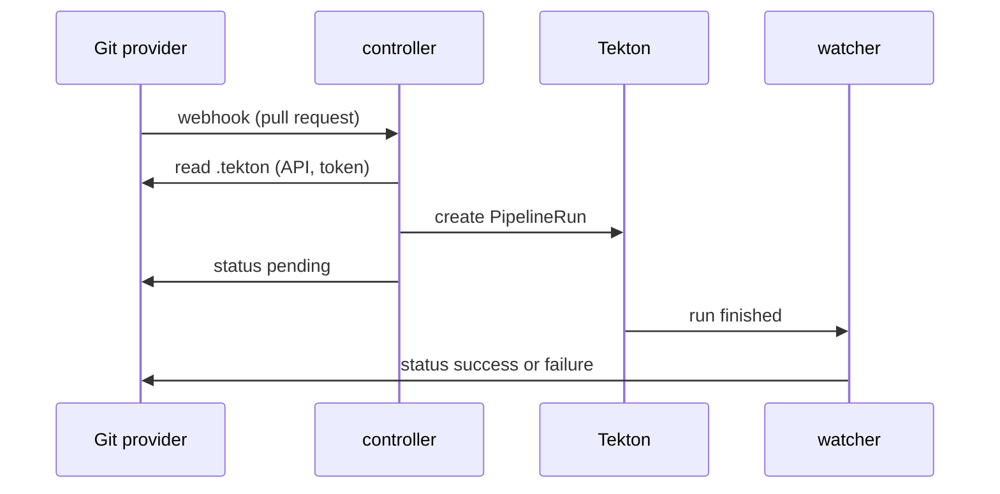

# What Pipelines-as-Code Is And How Events Become Runs

Tekton can run any pipeline, but on its own it does not know when to run one. Someone, or something, has to create a `PipelineRun` each time a developer pushes a commit or opens a pull request. Many teams solved this with scripts and webhook receivers of their own. Pipelines-as-Code is the Tekton project that does this job in a standard way, and it adds what CI users expect from a hosted service: the pipeline lives in the repository, and the result shows up on the pull request.

## The pipeline lives in the repository

Pipelines-as-Code (often shortened to PaC) is a Tekton project that runs PipelineRuns stored in a Git repository when Git events happen. The PipelineRuns live in a folder named `.tekton` at the top of the repository. Each file there is a template of a normal Tekton `PipelineRun`, with a few annotations that say which events it is for.

This is the "as code" part. The pipeline is versioned with the code, reviewed in the same pull request, and changed on a branch before it reaches `main`. A pull request that changes `.tekton/pull-request.yaml` is tested with the changed file, because Pipelines-as-Code reads `.tekton` from the branch of the event.

<!-- astrona:playground:renew -->

Your playground already holds such a repository. The `tester` pod in the namespace `gitea` can call the Gitea API, so define a small helper that runs `curl` there and filters the answer with `jq`. The user `starfleet` and its password are lab-only credentials:

```sh
gitea_get() {
  kubectl -n gitea exec deploy/tester -- sh -c \
    'curl -sS -u starfleet:starfleet-password "http://gitea-http.gitea.svc.cluster.local:3000/api/v1$1" | jq -r "$2"' _ "$1" "${2:-.}"
}
```

List the files of the `.tekton` folder on `main`, then print the one file it holds:

```sh
gitea_get '/repos/starfleet/bridge-app/contents/.tekton?ref=main' '.[].path'
kubectl -n gitea exec deploy/tester -- curl -sS -u starfleet:starfleet-password \
  'http://gitea-http.gitea.svc.cluster.local:3000/api/v1/repos/starfleet/bridge-app/raw/.tekton/pull-request.yaml?ref=main'
```

The first command prints `.tekton/pull-request.yaml`. The second prints a `PipelineRun` named `pull-request`. Its annotations `pipelinesascode.tekton.dev/on-event: "[pull_request]"` and `pipelinesascode.tekton.dev/on-target-branch: "[main]"` say: run me for pull requests into `main`. Its parameters take the values `{{ source_url }}` and `{{ revision }}`. These are dynamic variables: Pipelines-as-Code replaces them with the repository URL and the commit of the event before it creates the run.

## From a Git event to a PipelineRun

With the template in place, the rest is a chain of steps across two systems. The Git provider (the Git hosting service, here Gitea) sends a webhook, and three Pipelines-as-Code components in the cluster do the rest:



The diagram shows one pull request from the webhook to the final commit status.

A **webhook** is an HTTP request that the Git provider sends to a URL when an event happens. The **pipelines-as-code-controller** receives it, checks its signature, finds the matching `Repository` object, and reads the `.tekton` folder through the provider's API. It then picks the PipelineRuns whose annotations match the event, fills in the dynamic variables, and creates the PipelineRuns in the namespace of the `Repository`. Each one gets a generated name, such as `pull-request-x7k2p`, because the same template runs again for every event.

Tekton Pipelines then runs the PipelineRun like any other. The **pipelines-as-code-watcher** follows the PipelineRuns that Pipelines-as-Code created. When one finishes, the watcher reports the result back to the Git provider, cleans up old runs, and starts queued runs. The third component, the **pipelines-as-code-webhook**, is a Kubernetes admission webhook: it checks every `Repository` object when you create it.

## The Repository object

The `Repository` is a custom resource (`pipelinesascode.tekton.dev/v1alpha1`) that connects one Git repository URL to one namespace. It answers three questions for the controller: is this repository allowed to run pipelines in the cluster, in which namespace do its PipelineRuns go, and which credentials does Pipelines-as-Code use to talk to the provider about it.

Only one `Repository` may exist for a URL in the whole cluster. The admission webhook refuses a second one, even in another namespace. Without that rule, a user with rights in one namespace could create a `Repository` for someone else's repository and run their pipelines with that user's code and secrets.

## GitHub App, GitHub webhook and the other providers

Pipelines-as-Code supports several Git providers: GitHub, GitLab, Bitbucket Cloud, Bitbucket Data Center, and Forgejo (which also covers Gitea). How it connects to GitHub matters, because GitHub offers two ways.

A **GitHub App** is a GitHub integration with its own identity, installed on an organization or on chosen repositories. You create one App per cluster, for example with `tkn pac bootstrap`, and store its App ID, its private key and its webhook secret in the Secret `pipelines-as-code-secret` in the namespace `pipelines-as-code`. GitHub then sends events from every repository where the App is installed. For each event, Pipelines-as-Code asks GitHub for a short-lived token scoped to that repository, so nobody has to manage personal tokens. The App can use GitHub's Checks API, so results appear in the pull request's **Checks** tab with a re-run button, and GitOps comments such as `/retest` work. This is the recommended way on GitHub.

A **GitHub webhook** is the other way: a plain repository webhook plus a personal access token, a token that belongs to a user account. You store the token and the webhook secret in a Secret next to the `Repository`, and you add the webhook to each repository yourself (or with `tkn pac create repository`). Without an App there is no Checks API, so Pipelines-as-Code reports the result as a comment on the pull request, and the documentation says that GitOps comments such as `/retest` and `/ok-to-test` are not supported with this method. Use it when you cannot install an App.

GitLab, Bitbucket and Forgejo or Gitea work like the GitHub webhook: a token, a webhook secret, and a webhook per repository. For Forgejo and Gitea, the `Repository` sets `git_provider.type` to `forgejo`; the value `gitea` is kept as an alias. Pipelines-as-Code reports results as commit statuses and pull request comments there, and GitOps comments such as `/retest` and `/ok-to-test` work.

| | GitHub App | GitHub webhook | Gitea or Forgejo webhook |
| --- | --- | --- | --- |
| Credential | App ID and private key, one per cluster | Personal access token per `Repository` | Personal access token per `Repository` |
| Token for each event | Short-lived, made by Pipelines-as-Code | The stored token | The stored token |
| Where events come from | Every repository the App is installed on | One webhook per repository | One webhook per repository |
| Where results show | Checks tab | Pull request comment | Commit status and pull request comment |

Your labs use Gitea. A lab on your laptop cannot create a GitHub App, and GitHub cannot send webhooks to a cluster inside your machine. Gitea runs inside the cluster, so the whole chain (event, controller, PipelineRun, status) happens where you can see it. Everything you learn about the `Repository`, the `.tekton` folder and event matching works the same on GitHub.

You now know the model: templates in `.tekton`, a webhook from the provider, a controller that creates PipelineRuns in the namespace of the `Repository`, and a watcher that reports back. The open question is what the installation puts into the cluster.

## Common pitfalls

> [!WARNING]
> - **Thinking the file in `.tekton` is the PipelineRun that runs.** It is a template. Pipelines-as-Code creates a new PipelineRun object from it, with a generated name, for every matching event.
> - **Creating a second `Repository` for the same URL.** The admission webhook refuses it, even in another namespace. Delete or move the old one instead.
> - **Expecting a GitHub webhook setup to show results in the Checks tab.** Only a GitHub App uses the Checks API; a webhook setup reports in a pull request comment.
> - **Mixing up the two webhooks.** The Git provider's webhook carries events to the controller; the pipelines-as-code-webhook is a Kubernetes admission webhook that validates `Repository` objects.
