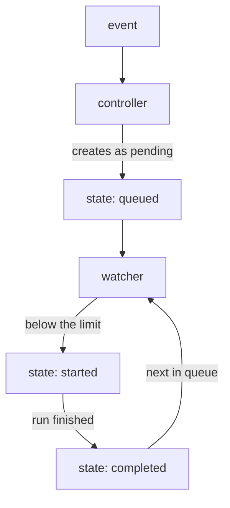

# Queue Runs With concurrency_limit

Every matching template of every event becomes a PipelineRun, and they all start at once. Two templates and ten quick commits to a pull request mean twenty runs competing for the same nodes, while only the newest commit matters. Pipelines-as-Code has two answers: a limit on how many runs of a repository may run at the same time, and the cancellation of runs that a newer commit made useless. This part covers both.

## The concurrency limit

`concurrency_limit` is a field of the `Repository` spec. It sets how many PipelineRuns of that repository may run at the same time; the rest wait in a queue. The smallest value is `1`, and the admission webhook refuses `0`. The limit counts the runs of one `Repository`, across all its templates and all its events.

With a limit, the work is split between the two Pipelines-as-Code components:



The diagram shows a run's states: the controller queues it, and the watcher starts it when a slot is free.

The pipelines-as-code-controller creates every PipelineRun with `spec.status: PipelineRunPending`, a Tekton field that tells Tekton not to start the run yet, and sets the label `pipelinesascode.tekton.dev/state` to `queued`. The pipelines-as-code-watcher keeps a queue per `Repository`. While fewer runs than the limit are running, it removes the pending status from the next queued run and sets its state to `started`; when a run finishes, it sets `completed` and starts the next one. Runs of one event start in alphabetical order of their names, so with a limit of `1`, `lint` runs before `unit-test`. A pending PipelineRun has no `startTime` yet; it gets one only when Tekton starts it.

<!-- astrona:playground:renew -->

Set a limit of `1` on the `Repository` in your playground.

Save this as `repository-bridge-app.yaml`:

```yaml
apiVersion: pipelinesascode.tekton.dev/v1alpha1
kind: Repository
metadata:
  name: bridge-app
  namespace: starfleet
spec:
  url: "http://gitea-http.gitea.svc.cluster.local:3000/starfleet/bridge-app"
  concurrency_limit: 1
  git_provider:
    type: gitea
    url: "http://gitea-http.gitea.svc.cluster.local:3000"
    secret:
      name: gitea-webhook-config
      key: provider.token
    webhook_secret:
      name: gitea-webhook-config
      key: webhook.secret
```

Apply it:

```sh
kubectl apply -f repository-bridge-app.yaml
```

The limit applies to events that arrive from now on; runs that already exist are not changed. Send a new event: open a pull request from a new branch with one change. Use a small helper that commits a file to a branch through the Gitea API:

```sh
gitea_put_file() {
  local branch="$1" file="$2" path="$3" message="$4" sha method body
  sha="$(kubectl -n gitea exec deploy/tester -- sh -c 'curl -sS -u starfleet:starfleet-password "$1" | jq -r ".sha // empty"' \
    _ "http://gitea-http.gitea:3000/api/v1/repos/starfleet/bridge-app/contents/$path?ref=$branch")"
  body="{\"branch\":\"$branch\",\"message\":\"$message\",\"content\":\"$(base64 < "$file" | tr -d '\n')\""
  if [ -n "$sha" ]; then method=PUT; body="$body,\"sha\":\"$sha\"}"; else method=POST; body="$body}"; fi
  kubectl -n gitea exec deploy/tester -- sh -c 'curl -sS -u starfleet:starfleet-password -X "$1" -H "Content-Type: application/json" --data "$2" "$3" | jq -r ".commit.sha"' \
    _ "$method" "$body" "http://gitea-http.gitea:3000/api/v1/repos/starfleet/bridge-app/contents/$path"
}
kubectl -n gitea exec deploy/tester -- curl -sS -u starfleet:starfleet-password -X POST -H 'Content-Type: application/json' \
  http://gitea-http.gitea:3000/api/v1/repos/starfleet/bridge-app/branches --data '{"new_branch_name":"feature-queue","old_branch_name":"main"}'
printf 'Queue test.\n' > queue.txt
gitea_put_file feature-queue queue.txt docs/queue.md "Test the queue"
kubectl -n gitea exec deploy/tester -- curl -sS -u starfleet:starfleet-password -X POST -H 'Content-Type: application/json' \
  http://gitea-http.gitea:3000/api/v1/repos/starfleet/bridge-app/pulls --data '{"head":"feature-queue","base":"main","title":"Test the queue"}'
```

Now watch the states. Run this a few times over the next minute:

```sh
kubectl get pipelineruns -n starfleet \
  -L pipelinesascode.tekton.dev/original-prname,pipelinesascode.tekton.dev/state --sort-by=.metadata.creationTimestamp
```

The two newest runs appear together. At first `lint` is `started` and `unit-test` is `queued`, with the status `PipelineRunPending`. About twenty seconds later `lint` is `completed`, `unit-test` is `started`, and later `completed`. Compare the times of the two runs:

```sh
kubectl get pipelineruns -n starfleet -L pipelinesascode.tekton.dev/state \
  -o custom-columns=NAME:.metadata.name,START:.status.startTime,DONE:.status.completionTime --sort-by=.metadata.creationTimestamp
```

The `START` of the newest `unit-test` run is not earlier than the `DONE` of the newest `lint` run: the runs did not overlap. Gitea shows a `pending` status for the queued run until it starts.

## Cancel runs that a newer commit replaced

A queue makes runs wait; it does not remove useless ones. When a developer pushes three commits to a pull request in a row, the runs for the first two are no longer interesting. The annotation `pipelinesascode.tekton.dev/cancel-in-progress: "true"` on a template tells Pipelines-as-Code to cancel the older running PipelineRuns of the same template, for the same pull request (or, for a push, the same branch), once the new one has started. The ConfigMap `pipelines-as-code` can switch this on for every repository with `enable-cancel-in-progress-on-pull-requests` and `enable-cancel-in-progress-on-push` (both `"false"` by default). With this annotation, closing a pull request also cancels its running PipelineRuns.

Two limits apply. `cancel-in-progress` cannot be used together with `concurrency_limit` in v0.52.0; choose one of the two for a repository. And it does not promise that only one run is active: the older runs are cancelled only after the new run has been created and started.

You now know how to keep a repository's runs under control: `concurrency_limit` queues them and the watcher starts them one slot at a time, in alphabetical order for one event; `cancel-in-progress` drops runs that a newer commit replaced. The open question is who is allowed to start runs at all.

## Common pitfalls

> [!WARNING]
> - **Setting `concurrency_limit: 0`.** The admission webhook refuses it; the smallest limit is `1`.
> - **Expecting the limit to change runs that already exist.** It applies to events that arrive after the change. Push a new commit.
> - **Looking for `startTime` on a queued run.** A pending PipelineRun has none until the watcher starts it.
> - **Combining `cancel-in-progress` with `concurrency_limit`.** That combination is not supported.
> - **Expecting a fixed order across events.** Alphabetical order applies to the runs of one event in the queue.

## Your mission: Queue Pull Request Runs With concurrency_limit

You can now limit how many runs of a repository run at the same time and read the queue from the PipelineRun labels and times. The graded lab gives you a pull request whose two pipelines ran in parallel, and asks you to limit the repository to one run at a time and prove that the next runs of the pull request did not overlap.

The lab runs in its own cluster, so first pause your playground. Nothing in it is lost:

```sh
astrona stop ats-128-playground-030-01
```

Then start the lab:

```sh
astrona run --git ssh://git@github.com/astrona-io/ATS128.git -c sections/section-030/module-01/labs/lab-01
```

The task is on the next page. Solve it on your own first. When you think you are done, send it for grading:

```sh
astrona submit -c sections/section-030/module-01/labs/lab-01
```

When the lab is done, remove it and start your playground again:

```sh
astrona destroy ats-128-lab-030-01
astrona start ats-128-playground-030-01
```
